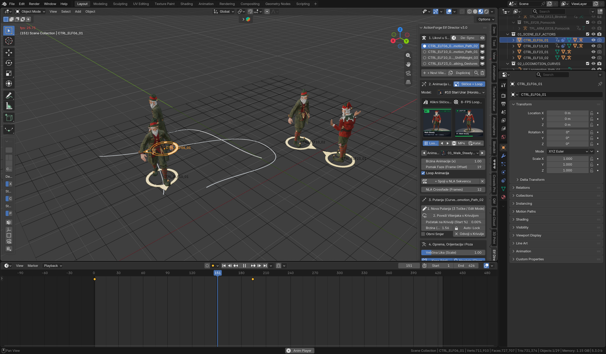
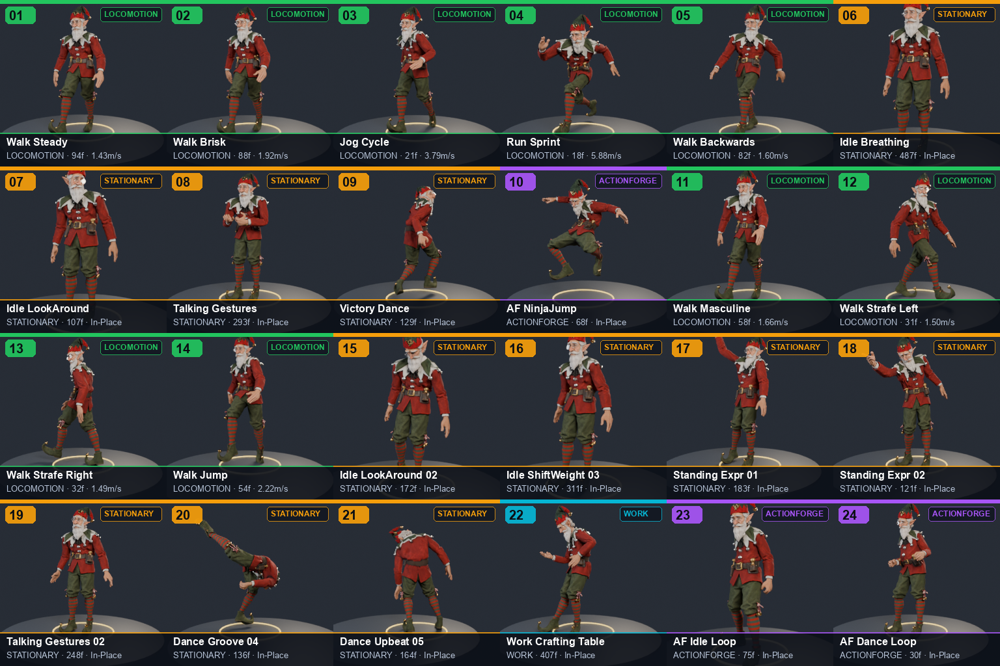
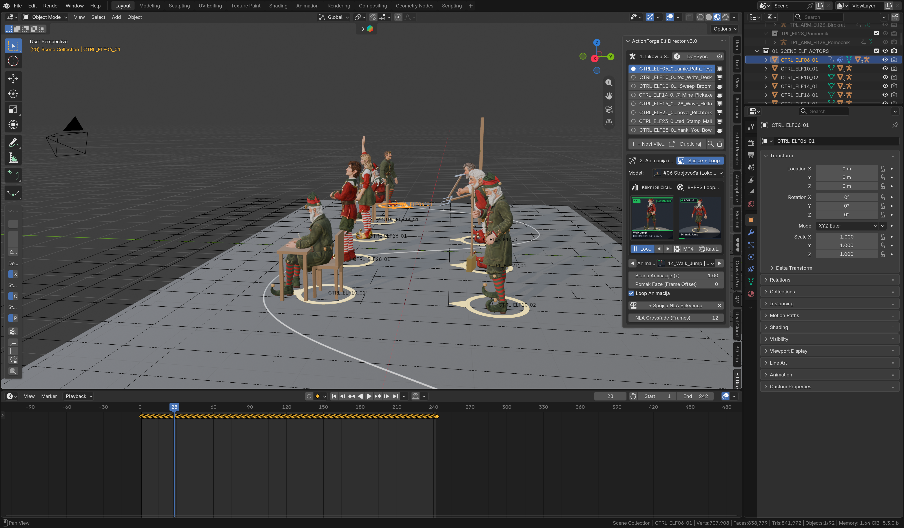
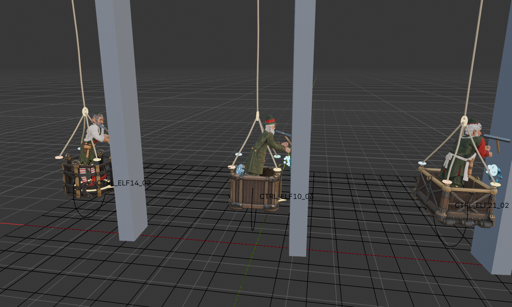
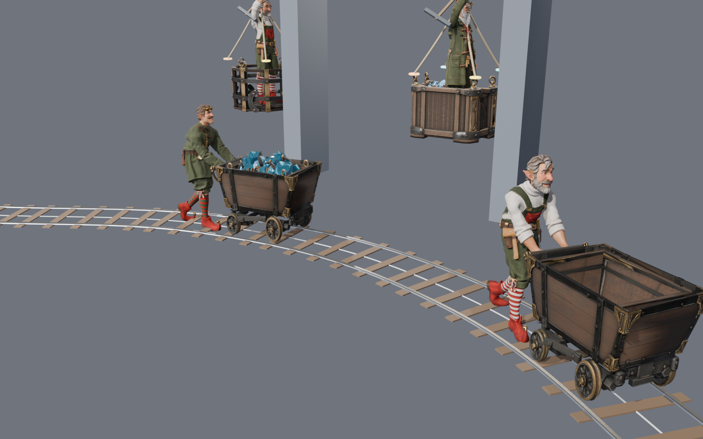

# ActionForge Elf Animation Director Studio v3.0

Sustav i Blender 4.x / 5.x dodatak (`elf_director`) za upravljanje sa **7 rigiranih vilenjaka**, **34 biomehanički zaključane animacije bez klizanja stopala**, hodanjem po krivuljama, višeslojnim NLA sekvencerom, rudarskim košarama na užadi s fizikom njihala, vagonetima na tračnicama, podzemnim žičarama s dinamikom provjesa sajle te modularnim `Elf Rig Studio` alatom za spajanje i Weight Paint 4-dijelnih likova (`BODY` + `HEAD` + `HAT` + `GLASSES`).



---

## Copy-Paste Prompt za Tvog AI Agenta (Claude Code, Antigravity, Cursor, Windsurf)

Kopiraj donji okvir i zalijepi ga svom AI agentu. Agent će sam klonirati repozitorij, sastaviti bazu modela i animacija, instalirati i uključiti dodatak u tvom Blenderu te pripremiti gotovu `.blend` scenu:

```text
Kloniraj javni repozitorij https://github.com/timon2200/elf-director-studio.git i postavi mi cijeli ActionForge Elf Animation Director Studio v3.0 u moj Blender:

1. Kloniraj repozitorij:
   git clone https://github.com/timon2200/elf-director-studio.git
   cd elf-director-studio

2. Pokreni univerzalnu instalacijsku skriptu (automatski spaja database/elf_assets_library.blend iz .part01 i .part02, upisuje putanje do 3D modela, instalira add-on u sve verzije Blendera 4.x/5.x na računalu, aktivira ga u Blender User Preferences i gradi gotovu elf_director_quickstart.blend scenu):
   python3 install_elf_studio.py --download-scenes

3. Pročitaj AGENTS.md u korijenu repozitorija. Ako imaš spojen Blender MCP (execute_blender_code) na moj otvoreni Blender, odmah u živom Blenderu pokreni bootstrap_director.py i ed.integrate_into_scene(spawn_demo=True) tako da mi se u 3D Viewportu pojave vilenjaci i N-Panel kartica "Elf Director".
```

---

## Izravno Preuzimanje Gotovih `.blend` Scena i `.zip` Dodatka (GitHub Release v3.0.0)

Ako želiš odmah otvoriti gotove Blender scene ili ručno instalirati `.zip` kroz *Edit -> Preferences -> Add-ons -> Install from Disk*:

- **[elves_animation_director_studio.blend (488 MB)](https://github.com/timon2200/elf-director-studio/releases/download/v3.0.0/elves_animation_director_studio.blend)** — kompletni studio s učitanih 7 vilenjaka, krivuljama hodanja, rudarskim košarama, vagonetima i žičarom.
- **[minecart_pusher_demo.blend (395 MB)](https://github.com/timon2200/elf-director-studio/releases/download/v3.0.0/minecart_pusher_demo.blend)** — demonstracijska scena guranja rudarskog vagoneta po zakrivljenoj uskotračnoj pruzi.
- **[elf_assets_library.blend (112 MB)](https://github.com/timon2200/elf-director-studio/releases/download/v3.0.0/elf_assets_library.blend)** — središnja baza sa 7 rigiranih predložaka vilenjaka i 34 pečene animacije (skripta `install_elf_studio.py` je automatski sastavlja iz `.part01` i `.part02` datoteka u repozitoriju).
- **[elf_director_addon.zip (166 KB)](https://github.com/timon2200/elf-director-studio/releases/download/v3.0.0/elf_director_addon.zip)** — samostalni Blender Add-on arhiv.

---

## Što Sadrži Paket

### 1. Sedam Rigiranih Vilenjaka i 34 Animacije (`AF_01` – `AF_34`)

Svaki vilenjak ima 71 kost (`ARM_Elf_Hero`), modularnu kapu (`HAT`) i naočale (`GLASSES`) te podni prstenasti kontroler (`CTRL_*`). Klikom na bilo koji dio tijela vilenjaka u 3D prostoru automatski se odabire njegov kontroler.

| ID | Lik | Modularna Oprema |
| :--- | :--- | :--- |
| `ELF06` | `#06 Strojovođa (Lokomotiva)` | Naočale |
| `ELF10` | `#10 Stari Urar (Toranj Vijećnice)` | Kapa sa zvončićem + urarske lupe |
| `ELF14` | `#14 Majstor Stolar` | Čisto tijelo i glava |
| `ELF16` | `#16 Bojadišarica Igračaka` | Čisto tijelo i glava |
| `ELF21` | `#21 Pekar Medenjaka` | Čisto tijelo i glava |
| `ELF23` | `#23 Stari Birokrat (Pošta)` | Kapa + naočale |
| `ELF28` | `#28 Osobni Pomoćnik Djeda` | Čisto tijelo i glava |



Katalog od **34 animacije** pokriva:
- **Kretanje (`LOCOMOTION`):** `AF_01_Walk_Steady`, `AF_02_Walk_Brisk`, `AF_03_Jog_Cycle`, `AF_04_Run_Sprint`, `AF_05_Walk_Backwards`, `AF_11_Walk_Masculine`, `AF_12_Walk_Strafe_Left`, `AF_13_Walk_Strafe_Right`, `AF_14_Walk_Jump`, `AF_34_Walk_Push_Minecart`.
- **Rad i Alati (`WORK` — CMU/Bandai optički mocap + artikulacija 30 kostiju prstiju):** `AF_22_Work_Crafting_Table`, `AF_25_Climb_Ladder` (penjanje uz ljestve), `AF_26_Seated_Stamp_Mail` (pečatiranje pisama za stolom), `AF_27_Mine_Pickaxe` (rudarenje krampom), `AF_30_Shovel_Pitchfork` (lopatanje), `AF_31_Sweep_Broom` (metenje), `AF_32_Seated_Write_Desk` (pisanje perom uz umakanje u tintu), `AF_33_Climb_Stairs` (penjanje uz stepenice).
- **Stajanje, Dijalog i Reakcije (`STATIONARY` / `ACTIONFORGE`):** `AF_06_Idle_Breathing`, `AF_07_Idle_LookAround`, `AF_08_Talking_Gestures`, `AF_09_Victory_Dance`, `AF_10_ActionForge_NinjaJump`, `AF_15`..`AF_21`, `AF_23`, `AF_24`, `AF_28_Wave_Hello` (mahanje), `AF_29_Thank_You_Bow` (naklon).

---

### 2. Višeslojni NLA Sekvencer i Hodanje po Krivuljama bez Klizanja Stopala



- **NLA Sekvencer:** Slaži nizove animacija (npr. *Hodanje -> Kopanje krampom -> Mahanje*) uz automatski *Crossfade* prijelaz. Gumb **`Auto-Fill [A]`** prilagođava broj ponavljanja hoda točnoj duljini nacrtane krivulje.
- **Hod po Krivulji (`Zero-Slip Curve Locomotion`):** Nacrtaj krivulju u 3D prostoru i poveži jednog ili više vilenjaka. Sustav re-uzorkuje krivulju na jednoliku duljinu luka i usklađuje brzinu koraka s duljinom nogu i skalom svakog pojedinog vilenjaka.

---

### 3. Rudarske Košare na Užadi i Fizika Njihala (`elf_director.cliff_baskets`)



- **4 Tripo 3D modela košara i 3 modularna paketa tereta** (`assets/models/glb/cliff_baskets/`).
- **4 Interaktivna Gizmo prstena (`GIZMO_Pin_01..04`)** za prikvačivanje užadi na obod košare, kuka sabirnice (`4 -> 1` ili paralelno `4 -> 4`) i gornja kolotura vitla.
- **Analitička fizika prigušenog njihala i odguravanja od ledenog zida:** Dok vilenjak u košari izvodi `AF_27_Mine_Pickaxe`, udarac krampa u zid odbija košaru unatrag i izbacuje krhotine plavog leda (`VFX_IceBurst`). Čim vilenjak prijeđe u mirnu animaciju (`Idle`), košara se glatko umiruje na `0.000 m`.

---

### 4. Guranje Vagoneta po Tračnicama (`elf_director.minecart_pusher`)



- **Prazni i puni rudarski vagonet** (`SM_Minecart_01_Empty.glb` i `SM_Minecart_02_Full_Loaded.glb` s košarom i kristalima leda).
- **1-Klik spajanje na vilenjaka:** Automatski postavlja ruke vilenjaka na stražnju prečku vagoneta (`AF_34_Walk_Push_Minecart`).
- **Tangentno praćenje zavoja i 3D generator pruge:** Dok vilenjak hoda po bilo kojoj krivulji, sva 4 kotača vagoneta prate zakrivljene tračnice ispred njega, a Geometry Nodes modifikator (`GN_Minecart_Rails_On_Curve`) iz iste krivulje gradi čelične tračnice i bukove pragove.

---

### 5. Podzemne Žičare i Gondole s Provjesom Sajle (`elf_director.ropeway_gondolas`)

- **Interaktivne Null točke stupova (`GIZMO_RW_*_Null_01..N`):** Pomicanjem, dodavanjem ili brisanjem Null točaka u 3D Viewportu cijela zatvorena petlja žičare, nagib kolotura i stupovi prilagođavaju se u stvarnom vremenu.
- **Točni matematički provjes sajle (hiperbolička lančanica + Greenova funkcija opterećenja):** Sajla se prirodno uvija pod vlastitom težinom i dodatno propada točno ispod svake putničke ili teretne gondole u pokretu, uz `0.000 mm` razmaka između sajle i hvataljke gondole.

---

### 6. Modularni `Elf Rig Studio` za 4-Dijelne Likove (`character_rig_studio/`)

U mapi `character_rig_studio/` nalazi se kompletni N-Panel alat (`elf10_sculpt_rig_studio.py`, `elf_studio_factory.py` i vodič `elf-3d-character-pipeline.md`) za izradu i riganje vlastitih 4-dijelnih likova (`BODY` + `HEAD AND HAIR` + `HAT` + `GLASSES`) kroz 5 koraka između čovjeka i AI agenta:
1. Ručno poravnavanje glave, kape i naočala na tijelo + `Sculpt Grab`.
2. Ručno namještanje 71 kosti (`Edit Mode` + `X-Axis Mirror`).
3. Oštri zglobni Bind (`Crisp Axial Joint-Plane Skinning ±1.8 cm`) + 1-klik Weight Paint studio sa zaključavanjem ručnih težina (`elf01_lock_weights`).
4. Prijenos Mixamo/Mocap animacija sa sekundarnom fizikom kape, zvončića i brade.

---

## Ručna Instalacija (Bez AI Agenta)

1. Kloniraj repozitorij i pokreni instalacijsku skriptu:
   ```bash
   git clone https://github.com/timon2200/elf-director-studio.git
   cd elf-director-studio
   python3 install_elf_studio.py
   ```
2. Otvori Blender 4.x ili 5.x (ili dvoklikni na generirani `elf_director_quickstart.blend`).
3. U 3D Viewportu pritisni **`N`** i otvori karticu **`Elf Director`**.
4. Klikni **`Učitaj Bazu Vilenjaka (Integrate Library)`** za uvoz svih 7 vilenjaka i 34 animacije u bilo koju scenu.

---

## Struktura Repozitorija

```text
elf-director-studio/
├── README.md                        # Upute za ljude + Copy-Paste prompt za AI agenta
├── AGENTS.md                        # Tehnička specifikacija i Python SDK za AI agente
├── install_elf_studio.py            # Univerzalni 1-klik instalator (macOS / Windows / Linux)
├── bootstrap_director.py            # Skripta za izravno pokretanje u Blenderu ili preko MCP-a
├── elf_director_addon.zip           # Gotov Blender Add-on paket za Preferences -> Install
├── elf_director/                    # Glavni Python paket i Blender Add-on (`import elf_director as ed`)
│   ├── __init__.py
│   ├── constants.py                 # Dinamičke putanje, spajanje .part datoteka i roster 7 vilenjaka
│   ├── database.py                  # Učitavanje baze i biomehanički retargeting bez klizanja
│   ├── rig_actors.py                # Kontroleri (`CTRL_*`), zamjena modela i opreme (`HAT`/`GLASSES`)
│   ├── locomotion.py                # Jednoliko uzorkovanje krivulja i hod bez klizanja stopala
│   ├── nla_sequencer.py             # Višeslojni NLA sekvencer, Auto-Fill i aditivna poza
│   ├── human_tools.py               # Prianjanje uz tlo (Raycast), okretanje prema kameri i skala
│   ├── cliff_baskets.py             # Rudarske košare, 4-Gizmo užad i fizika njihala/krampa
│   ├── cliff_baskets_ui.py          # N-Panel sučelje za rudarske košare
│   ├── minecart_pusher.py           # Vagoneti, tangentno praćenje zavoja i 3D generator tračnica
│   ├── minecart_pusher_ui.py        # N-Panel sučelje za vagonete i prugu
│   ├── ropeway_gondolas.py          # Podzemne žičare, Null točke stupova i provjes sajle
│   ├── ropeway_gondolas_ui.py       # N-Panel sučelje za žičare i gondole
│   ├── operators_ui.py              # Glavni N-Panel `Elf Director`
│   ├── previews.py                  # 8-FPS animirane sličice u N-Panelu
│   └── agent_sdk.py                 # Agent-First Python SDK
├── database/
│   ├── elf_assets_library.blend.part01  # 1. dio baze (automatski se spaja u elf_assets_library.blend)
│   ├── elf_assets_library.blend.part02  # 2. dio baze
│   ├── registry.json                # JSON katalog svih 7 vilenjaka i 34 animacije
│   ├── animations_dropin/           # Mapa za automatski uvoz novih .glb / .fbx animacija
│   └── previews/                    # Ikone vilenjaka, 8-FPS flipbook sličice i HTML katalog
├── assets/models/glb/
│   ├── cliff_baskets/               # 7 Tripo 3D .glb modela košara i rudarskog tereta
│   ├── minecart/                    # Prazni i puni 3D model rudarskog vagoneta (.glb)
│   └── ropeway_gondolas/            # Low-poly 3D modeli putničkih/teretnih gondola i kolotura
├── character_rig_studio/            # 4-dijelni Elf Rig Studio (BODY + HEAD + HAT + GLASSES)
│   ├── elf10_sculpt_rig_studio.py
│   ├── elf01_sculpt_rig_studio.py
│   ├── elf_studio_factory.py
│   └── elf-3d-character-pipeline.md
└── tests/
    └── test_elf_director_suite.py   # Automatizirani testovi u headless Blenderu
```
